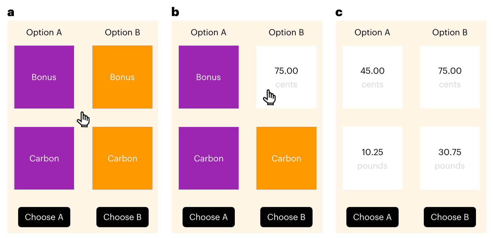

{#fig-cet fig-alt="Three panels of a decision screen with two options, A and B. Each option has a Bonus box and a Carbon box. In panel a all four boxes are closed and coloured; in panel b the mouse has opened Option B's bonus, showing 75.00 cents; in panel c all boxes are open, showing bonuses of 45.00 and 75.00 cents and carbon emissions of 10.25 and 30.75 pounds."}

Wyss, A. M., Guizar Rosales, E. T., Schulte-Mecklenbeck, M., Buchs, J., Hahnel, U. J. J., & Knoch, D. (in press). [Political affiliation impacts climate attention and choice beyond extreme weather exposure](https://doi.org/10.1038/s41558-026-02765-z). *Nature Climate Change*. [PDF](/_content/_pdf/Wyss2026.pdf)

# The question

Extreme weather is getting more frequent, and a popular hope is that living through a heatwave or a flood will make people take climate change more seriously. In a country as polarised as the US, that hope runs into politics: the same storm can be read as evidence of climate change or as just bad weather.

There is good reason for the hope. In our work on COVID-19, people who had contracted the virus themselves consistently rated the risk of infection higher than those who had not (Schulte-Mecklenbeck et al., 2024) -- personal experience mattered. But an infection is an unambiguous experience with an obvious cause. Extreme weather is different: living in a county hit by a storm or a heatwave does not necessarily mean being affected by it, and whether the event has anything to do with climate change is open to interpretation. So it is not obvious that exposure to extreme weather works the same way.

We wanted to know how political affiliation and exposure to extreme weather shape not only *what* people choose, but *how* they search for climate-relevant information before choosing.

# What we did

This is a Registered Report (Munafò et al., 2017) -- hypotheses, design and analysis plan were reviewed and accepted before we collected a single data point. A sample of 1,451 US participants worked through a new variant of the Carbon Emission Task (@fig-cet). In each trial they picked between two options: one paid a higher bonus, the other caused fewer carbon emissions. The emissions were real -- they were implemented by trading certificates in a cap-and-trade system.

The process-tracing part is what I like most about the design. Using MouselabWEB (Willemsen & Johnson, 2019), all information sat behind boxes and only opened while the mouse hovered over it. That gives us dwell time on bonus versus carbon information -- a direct measure of where attention goes during the decision, not just the decision itself.

We then linked every participant to county-level records of extreme weather events from the US National Oceanic and Atmospheric Administration (NOAA), so exposure is measured objectively rather than self-reported, and we asked people whether they attribute such events to climate change.

# Try it yourself

Below is a small version of the task. You get five choices between two options, each with a bonus and an amount of carbon emissions. Start each trial by clicking the **+** in the middle, then move your mouse over the boxes to see what is behind them (on a phone: press and hold a box). When you have seen enough, choose. Nothing here is paid out and no carbon is emitted -- in the study both were real.

```{=html}
<style>
#cet-demo {
  --cet-a: #9c27b0; --cet-b: #ff9800; --cet-bg: #fdf3e6;
  --cet-bonus: #446e9b; --cet-carbon: #3cb521;
  max-width: 400px; margin: 1.5rem auto; font-size: 0.95rem;
}
#cet-demo [hidden] { display: none !important; }
#cet-demo .cet-stage { background: var(--cet-bg); border-radius: 6px; padding: 14px; position: relative; user-select: none; -webkit-user-select: none; }
#cet-demo .cet-head, #cet-demo .cet-grid, #cet-demo .cet-btns { display: grid; grid-template-columns: 1fr 1fr; gap: 14px; text-align: center; }
#cet-demo .cet-head { margin-bottom: 8px; }
#cet-demo .cet-grid { row-gap: 14px; }
#cet-demo .cet-box { aspect-ratio: 1 / 1; display: flex; flex-direction: column; align-items: center; justify-content: center; color: #fff; border-radius: 2px; cursor: pointer; touch-action: none; }
#cet-demo .cet-box.a { background: var(--cet-a); }
#cet-demo .cet-box.b { background: var(--cet-b); }
#cet-demo .cet-box.open { background: #fff; color: #222; }
#cet-demo .cet-box .unit { color: #aaa; font-size: 0.85em; }
#cet-demo .cet-btns { margin-top: 14px; }
#cet-demo .cet-btns button { background: #000; color: #fff; border: 0; border-radius: 6px; padding: 8px 0; width: 70%; justify-self: center; cursor: pointer; }
#cet-demo .cet-btns button:disabled { opacity: 0.3; cursor: default; }
#cet-demo .cet-fix { position: absolute; inset: 0; display: flex; align-items: center; justify-content: center; background: rgba(253, 243, 230, 0.9); border-radius: 6px; }
#cet-demo .cet-fix button { font-size: 1.8rem; width: 56px; height: 56px; border-radius: 50%; border: 2px solid #222; background: #fff; cursor: pointer; line-height: 1; }
#cet-demo .cet-progress { text-align: center; color: #777; margin-top: 8px; font-size: 0.85rem; }
#cet-demo .cet-result h4 { margin-top: 0; }
#cet-demo .cet-bar { display: flex; height: 18px; border-radius: 3px; overflow: hidden; background: #eee; }
#cet-demo .cet-bar span { display: block; height: 100%; }
#cet-demo .cet-legend { display: flex; gap: 16px; font-size: 0.85rem; margin: 6px 0 12px; }
#cet-demo .cet-legend i { display: inline-block; width: 10px; height: 10px; margin-right: 5px; border-radius: 2px; }
#cet-demo table { width: 100%; font-size: 0.85rem; }
#cet-demo td, #cet-demo th { padding: 3px 6px; vertical-align: middle; }
#cet-demo .cet-again { margin-top: 10px; }
</style>

<div id="cet-demo">
  <div class="cet-task">
    <div class="cet-stage">
      <div class="cet-head"><div>Option A</div><div>Option B</div></div>
      <div class="cet-grid"></div>
      <div class="cet-btns"><button data-choice="0">Choose A</button><button data-choice="1">Choose B</button></div>
      <div class="cet-fix"><button aria-label="Start trial">+</button></div>
    </div>
    <div class="cet-progress"></div>
  </div>
  <div class="cet-result" hidden></div>
</div>

<script>
(function () {
  const root = document.getElementById('cet-demo');
  // Each pair: [bonus in cents, carbon in pounds] for the low- and high-bonus option.
  // The higher bonus always comes with more carbon, so every trial is a trade-off.
  const PAIRS = [
    [[45, 10.25], [75, 30.75]],
    [[20, 5.50], [60, 24.00]],
    [[50, 12.00], [65, 41.50]],
    [[30, 8.25], [90, 35.00]],
    [[55, 15.50], [70, 22.25]]
  ];
  const UNIT = { bonus: 'cents', carbon: 'pounds' };
  const LABEL = { bonus: 'Bonus', carbon: 'Carbon' };

  const grid = root.querySelector('.cet-grid');
  const fix = root.querySelector('.cet-fix');
  const chooseBtns = root.querySelectorAll('.cet-btns button');
  const progress = root.querySelector('.cet-progress');
  const task = root.querySelector('.cet-task');
  const result = root.querySelector('.cet-result');

  let rows, trials, t, log, openBox, openedAt;

  const shuffle = a => a.map(x => [Math.random(), x]).sort((p, q) => p[0] - q[0]).map(p => p[1]);

  function start() {
    // As in the study: attribute rows are fixed per person, option sides vary per trial.
    rows = Math.random() < 0.5 ? ['bonus', 'carbon'] : ['carbon', 'bonus'];
    trials = shuffle(PAIRS).map(pair => {
      const greenLeft = Math.random() < 0.5;
      const opts = greenLeft ? [pair[0], pair[1]] : [pair[1], pair[0]];
      return { opts: opts.map(o => ({ bonus: o[0], carbon: o[1] })), green: greenLeft ? 0 : 1 };
    });
    t = 0; log = [];
    result.hidden = true; task.hidden = false;
    showTrial();
  }

  function showTrial() {
    const tr = trials[t];
    grid.innerHTML = '';
    rows.forEach(attr => {
      [0, 1].forEach(side => {
        const box = document.createElement('div');
        box.className = 'cet-box ' + (side ? 'b' : 'a');
        box.dataset.attr = attr;
        box.dataset.side = side;
        box.innerHTML = '<span>' + LABEL[attr] + '</span>';
        const val = tr.opts[side][attr];
        box.dataset.value = val.toFixed(2);
        box.addEventListener('pointerenter', e => { if (e.pointerType === 'mouse') open(box); });
        box.addEventListener('pointerleave', e => { if (e.pointerType === 'mouse') close(); });
        box.addEventListener('pointerdown', e => { if (e.pointerType !== 'mouse') { e.preventDefault(); open(box); } });
        ['pointerup', 'pointercancel'].forEach(ev =>
          box.addEventListener(ev, e => { if (e.pointerType !== 'mouse') close(); }));
        grid.appendChild(box);
      });
    });
    log.push({ bonus: 0, carbon: 0, visits: 0, choice: null, green: tr.green });
    chooseBtns.forEach(b => b.disabled = true);
    fix.hidden = false;
    progress.textContent = 'Trial ' + (t + 1) + ' of ' + trials.length;
  }

  function open(box) {
    if (!fix.hidden || openBox === box) return;
    close();
    openBox = box; openedAt = performance.now();
    box.classList.add('open');
    box.innerHTML = '<span>' + box.dataset.value + '</span><span class="unit">' + UNIT[box.dataset.attr] + '</span>';
    log[t].visits++;
  }

  function close() {
    if (!openBox) return;
    log[t][openBox.dataset.attr] += performance.now() - openedAt;
    openBox.classList.remove('open');
    openBox.innerHTML = '<span>' + LABEL[openBox.dataset.attr] + '</span>';
    openBox = null;
  }

  fix.querySelector('button').addEventListener('click', () => {
    fix.hidden = true;
    chooseBtns.forEach(b => b.disabled = false);
  });

  chooseBtns.forEach(btn => btn.addEventListener('click', () => {
    close();
    log[t].choice = +btn.dataset.choice;
    t++;
    if (t < trials.length) showTrial(); else showResult();
  }));

  function showResult() {
    task.hidden = true;
    const sum = k => log.reduce((s, r) => s + r[k], 0);
    const bonus = sum('bonus'), carbon = sum('carbon'), total = bonus + carbon;
    const greenChoices = log.filter(r => r.choice === r.green).length;
    const pct = total ? Math.round(100 * carbon / total) : 0;
    const sec = ms => (ms / 1000).toFixed(1) + ' s';
    const bar = (b, c) => {
      const tot = b + c || 1;
      return '<div class="cet-bar"><span style="width:' + (100 * b / tot) + '%;background:var(--cet-bonus)"></span>' +
             '<span style="width:' + (100 * c / tot) + '%;background:var(--cet-carbon)"></span></div>';
    };
    result.innerHTML =
      '<h4>Your decision process</h4>' +
      '<p>You spent <strong>' + pct + '%</strong> of your looking time on carbon information and chose the lower-emission option in <strong>' +
      greenChoices + ' of ' + log.length + '</strong> trials.</p>' +
      bar(bonus, carbon) +
      '<div class="cet-legend"><span><i style="background:var(--cet-bonus)"></i>Bonus ' + sec(bonus) + '</span>' +
      '<span><i style="background:var(--cet-carbon)"></i>Carbon ' + sec(carbon) + '</span></div>' +
      '<table><thead><tr><th>Trial</th><th style="width:45%">Dwell time</th><th>Boxes opened</th><th>Choice</th></tr></thead><tbody>' +
      log.map((r, i) => '<tr><td>' + (i + 1) + '</td><td>' + bar(r.bonus, r.carbon) + '</td><td>' + r.visits + '</td><td>' +
        (r.choice === r.green ? 'lower carbon' : 'higher bonus') + '</td></tr>').join('') +
      '</tbody></table>' +
      '<button class="btn btn-outline-primary btn-sm cet-again">Try again</button>';
    result.querySelector('.cet-again').addEventListener('click', start);
    result.hidden = false;
  }

  start();
})();
</script>
```

This is exactly the information the study records: how long each box was open, how often it was opened, and in which order -- for 1,451 people, together with their choices. Dwell time on carbon versus bonus information is the attention measure in the paper.

# What we found

- **Politics matters.** Democrats spent more time on carbon information and made more pro-climate choices than Republicans.
- **Exposure alone does not.** Objectively measured extreme weather exposure did not moderate these differences. Living in an affected county is evidently not the same as the personal experience that shaped risk judgments during COVID-19.
- **Interpretation does.** People who attribute extreme weather to climate change attended more to carbon information and chose more pro-climate options -- and attribution moderated the effect of exposure on both.

In short: it is less the storm itself than how people make sense of it that shapes climate-relevant attention and choice.

Congratulations to Annika and Emmanuel, who led this work, and thanks to Julie, Ulf and Daria.

# References

Munafò, M. R., Nosek, B. A., Bishop, D. V. M., Button, K. S., Chambers, C. D., Percie du Sert, N., Simonsohn, U., Wagenmakers, E.-J., Ware, J. J., & Ioannidis, J. P. A. (2017). [A manifesto for reproducible science](https://doi.org/10.1038/s41562-016-0021). *Nature Human Behaviour*, *1*, 0021.

Schulte-Mecklenbeck, M., Wagner, G. G., & Hertwig, R. (2024). [How personal experiences shaped risk judgments during COVID-19](https://doi.org/10.1080/13669877.2024.2350712). *Journal of Risk Research*, *27*(3), 438--457.

Willemsen, M. C., & Johnson, E. J. (2019). (Re)Visiting the decision factory: Observing cognition with MouselabWEB. In M. Schulte-Mecklenbeck, A. Kühberger, & J. G. Johnson (Eds.), *A handbook of process tracing methods* (2nd ed., pp. 76--95). Routledge.

Wyss, A. M., Guizar Rosales, E. T., Schulte-Mecklenbeck, M., Buchs, J., Hahnel, U. J. J., & Knoch, D. (in press). [Political affiliation impacts climate attention and choice beyond extreme weather exposure](https://doi.org/10.1038/s41558-026-02765-z). *Nature Climate Change*.
